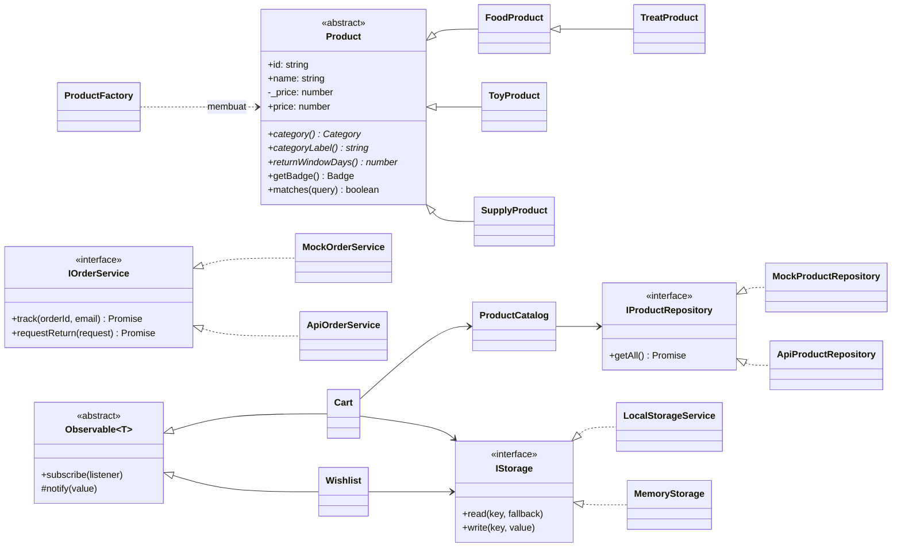
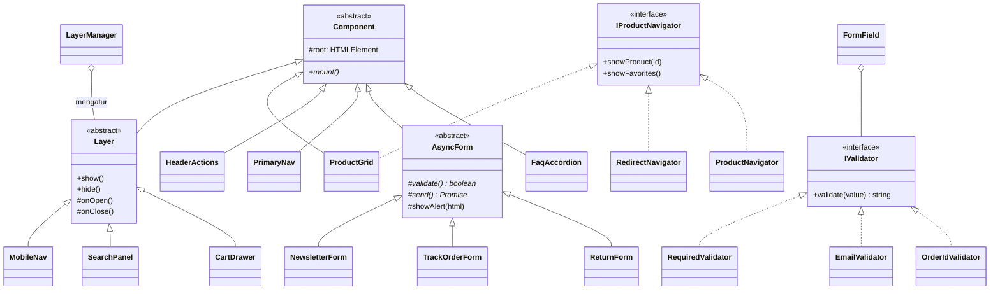
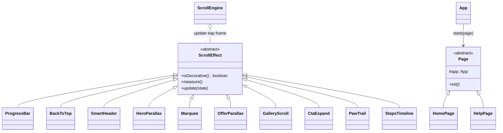

# MeowPlace — Frontend (TypeScript + OOP)

Tampilan memakai HTML + CSS, sedangkan seluruh logikanya ditulis dalam
**TypeScript berorientasi objek**. TypeScript dipilih karena punya `class`,
`interface`, `abstract`, `private`/`protected`, dan `enum`, dengan sintaks
yang sangat mirip C# (backend).

## Menjalankan

```bash
npm install        # sekali saja (memasang TypeScript & esbuild)
npm run build      # cek tipe (tsc) + gabungkan src/ menjadi assets/js/app.js
npm run dev        # build otomatis setiap kali file di src/ disimpan
```

Lalu buka `index.html` lewat Live Server atau `python -m http.server 5500`.
File `assets/js/app.js` adalah **hasil kompilasi**. Yang diedit selalu file di `src/`.

## Struktur `src/`

```
src/
├── main.ts                 titik masuk: pilih service (Mock/Api) & halaman
├── config.ts               useApi: false/true, alamat backend
├── app/App.ts              merakit semua objek bersama (dependency injection)
├── pages/                  Page (abstract) → HomePage, HelpPage
├── models/                 Product (abstract) & turunannya, ProductFactory, Order, enum, DTO
├── contracts/              semua interface (IProductRepository, IOrderService, IStorage, ...)
├── services/               Cart, Wishlist, ProductCatalog, ProductNavigator
│   ├── mock/               implementasi interface dengan data contoh
│   ├── api/                implementasi interface ke backend C# (HttpClient)
│   └── storage/            LocalStorageService, MemoryStorage, StorageFactory
├── ui/                     Component (abstract) & semua komponen tampilan
│   ├── layers/             Layer (abstract) → MobileNav, SearchPanel, CartDrawer
│   ├── forms/              AsyncForm (abstract), FormField, Validators, NewsletterForm
│   └── help/               TrackOrderForm, ReturnForm, FaqAccordion, HelpNav
├── effects/                ScrollEffect (abstract) & 10 animasi gulir + ScrollEngine
└── core/                   Observable<T>, Formatter, Motion, utilitas DOM
```

## Konsep OOP dan letaknya

| Konsep | Contoh di kode |
|---|---|
| **Class & Object** | `new Cart(storage, catalog)`, `new ProductGrid(...)`: setiap fitur adalah objek |
| **Encapsulation** | `Product` menyimpan harga di `private _price`, hanya bisa dibaca lewat getter `price`. Isi `Cart` (`private quantities`) hanya bisa diubah lewat `add()`, `setQuantity()`, `remove()` |
| **Inheritance** | `FoodProduct extends Product`, lalu `TreatProduct extends FoodProduct` (bertingkat). `CartDrawer extends Layer extends Component`. `HttpError extends Error` |
| **Abstraction** | Kelas `abstract`: `Product`, `Component`, `Layer`, `AsyncForm`, `ScrollEffect`, `Page`, `Observable<T>`. Masing-masing punya method/getter `abstract` yang wajib diisi turunannya |
| **Polymorphism** | `ScrollEngine` memanggil `effect.update(state)` pada 10 efek berbeda. `product.categoryLabel` dan `product.returnWindowDays` memberi hasil berbeda per jenis produk ("retur 14 hari" vs "30 hari" di keranjang). `NewsletterForm` meng-`override` `showAlert()` |
| **Interface** | `IProductRepository`, `IOrderService`, `INewsletterService`, `IStorage`, `INotifier`, `IProductNavigator`, `IMeasurable`, `IValidator`. Satu kelas bisa mengimplementasikan dua interface: `ProductGrid implements IProductNavigator, IMeasurable` |
| **Generics** | `Observable<T>`, `IStorage.read<T>()`, `HttpClient.get<T>()` |
| **Enum** | `Category`, `OrderStatus`, `ReturnReason` |
| **Static** | `ProductFactory.create()`, `Formatter.rupiah()`, `Cart.FREE_SHIPPING_MIN` |
| **Composition** | `FormField` berisi daftar `IValidator`. `LayerManager` menyimpan elemen overlay (karena sudah mewarisi `Observable`) |

### Design pattern yang dipakai

- **Factory**: `ProductFactory` membuat `FoodProduct`/`ToyProduct`/... sesuai kategori.
- **Observer**: `Cart`, `Wishlist`, `LayerManager` mewarisi `Observable<T>`. Ikon header & drawer berlangganan perubahan.
- **Template Method**: `AsyncForm.handleSubmit()` (validasi → loading → kirim → galat) dan `Layer` (`onOpen`/`onClose`).
- **Proxy**: `ProductNavigator` meneruskan perintah ke `ProductGrid` (halaman toko) atau `RedirectNavigator` (halaman lain).
- **Repository + Dependency Injection**: `App` menerima service lewat constructor, jadi pindah dari Mock ke API cukup ubah `config.ts`.

## Diagram kelas

### Model & service



### Komponen tampilan



### Animasi gulir & halaman


